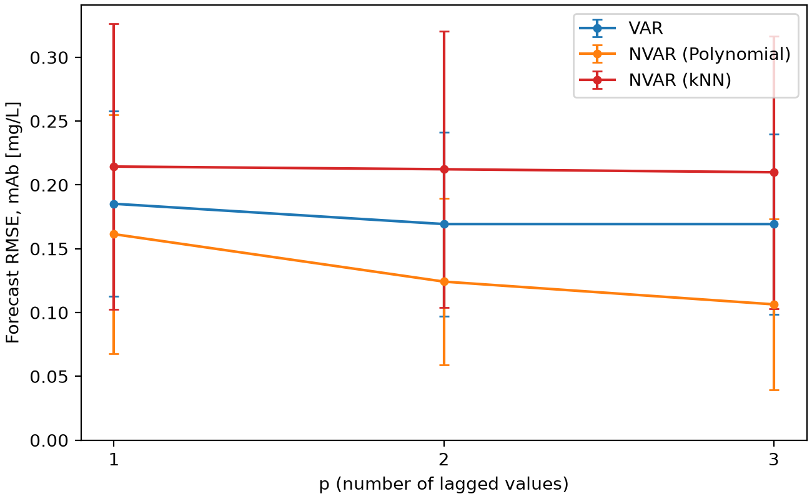
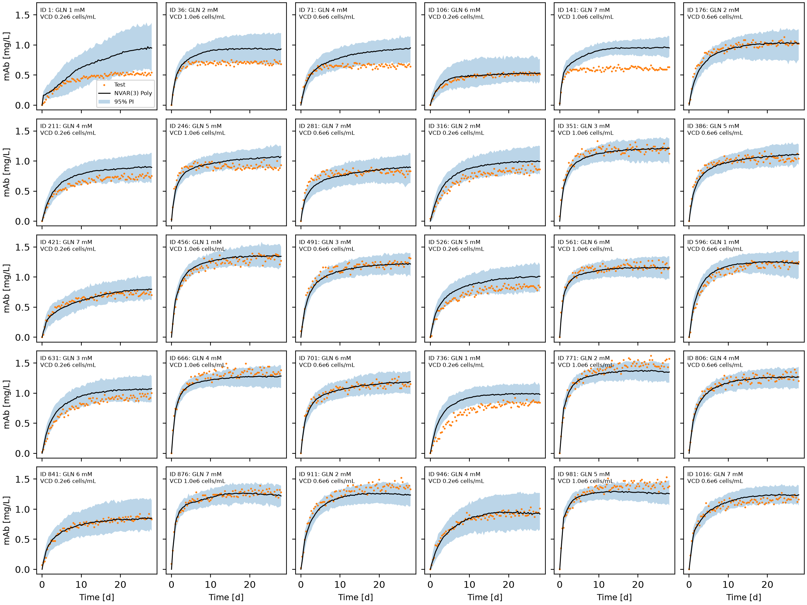
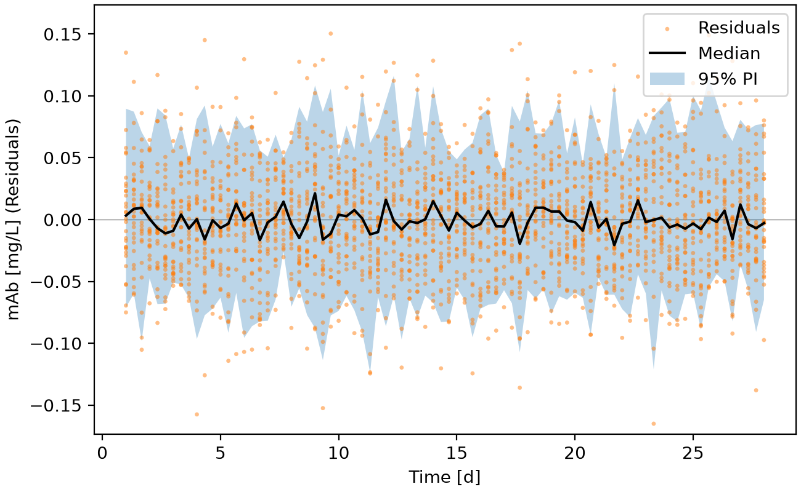
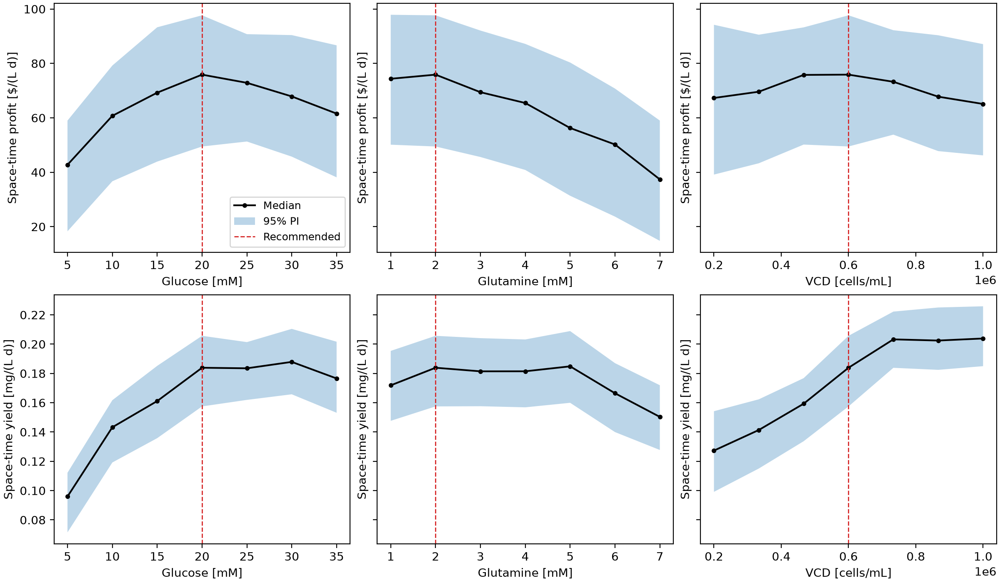
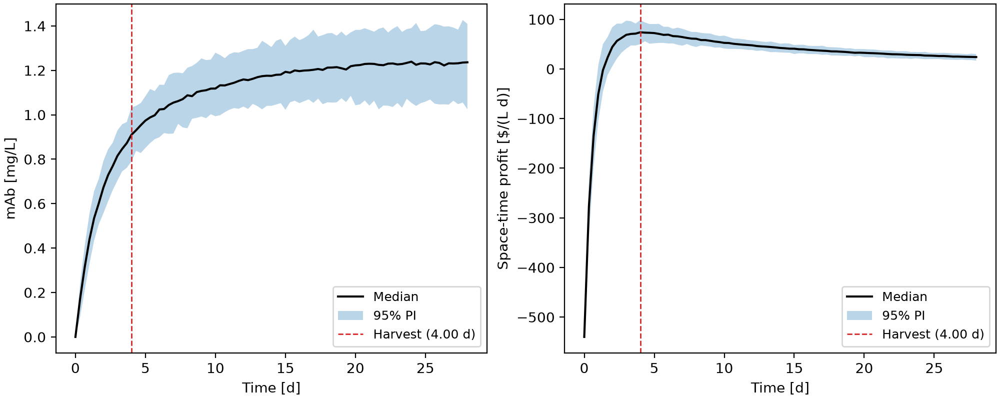

# Forecasting and Optimizing Monoclonal Antibody Production

The purpose of this project is to forecast monoclonal antibody (mAb) production in batch cell cultures, and to use
these forecasts to find the most profitable way to run the process. Starting from only the initial glucose, glutamine,
and viable cell density of a batch, the model predicts how the culture changes over time. By applying time series
machine learning, the initial conditions and harvest time can be chosen without running every possible batch.

## Highlights

- Built vector autoregressive (VAR) and non-linear vector autoregressive (NVAR) models using scikit-learn pipelines
- Evaluated forecasts using leave-one-batch-out cross-validation and grouped grid search cross-validation
- Quantified forecast uncertainty using white noise simulations and 95 % prediction intervals
- Optimized initial culture conditions and harvest time by screening 343 candidate batches
- Designed reusable classes for forecasting models, batches, and cross-validation

## Environment

- Python 3.14.7
- matplotlib 3.11.0
- numpy 2.5.2
- pandas 3.0.5
- scikit-learn 1.9.0

## Code Design

The program is run from `main.py`, which calls on three `.py` files in the `src` folder. `constants.py` stores fixed
settings such as column names, the costs and value of the cell culture, the hyperparameters to search, and the number
of simulations. `functions.py` contains general functions such as loading the dataset, generating lagged values, and
calculating the economics of a batch. `classes.py` contains the classes that hold the forecasting models, the batches,
and the cross-validation results. Keeping the bulk of the code in separate files means `main.py` is more streamlined
and increases the ease of editing.

### Data Loading

The program first reads every batch csv file in the `datasets` folder using pandas and combines them into one
DataFrame with a `Batch ID` column. The initial glucose, glutamine, and viable cell density (VCD) of each batch are read
from `initial_conditions.csv`. Batches with the same initial conditions (replicates) are given the same `Condition ID`.
The seven process variables (glucose, glutamine, lactate, ammonia, VCD, total cell density (TCD), and mAb) are taken as
the features. This stage is necessary because each batch is its own time series, so the batch ID has to stay with
every row so that batches can be kept separate later on.

### Preprocessing

Each batch is converted into lagged values (`x_lag`) and current values (`x_cur`). For a model with p lagged values,
each row of `x_lag` holds all seven process variables at the previous p time points, and `x_cur` holds them at the
current time point. The lagged values are made one batch at a time so that the end of one batch is never used to
predict the start of another. The data is then standardized with the `StandardScalerVAR` class. Unlike scikit-learn's
`StandardScaler`, which standardizes each column on its own, it calculates one mean and standard deviation for each
process variable across all of its lags. Standardization is needed because VCD is on the scale of 10^6 cells/mL while
mAb is on the scale of 1 mg/L.

### Model Setup

Each model is created as a `ForecastModel` object, which stores a name, a scikit-learn pipeline, and a grid of
hyperparameters to search. Three models are built, all beginning with `StandardScalerVAR`:

- A VAR pipeline: `LinearRegression`
- A polynomial NVAR pipeline: `PolynomialFeatures` &rarr; `LinearRegression`
- A kNN NVAR pipeline: `KNeighborsRegressor`

### Hyperparameter Optimization

For the polynomial model, degrees 2 and 3 are tested, and for the kNN model, values of k from 2 to 8 are tested. The
grid search uses `GroupKFold`, grouped by `Condition ID`, so that a batch and its replicates are never split between
the training and validation sets. The score is the RMSE of each process variable divided by its standard deviation,
averaged over all of the variables. Without this, the score would be decided almost entirely by VCD and TCD, since
their values are so much larger than the others. After fitting, the residuals of the training data are saved to be
used as white noise.

### Forecasting

The model forecasts a whole batch from its initial conditions. Lactate, ammonia, and mAb start at zero, and TCD starts
equal to VCD. Each prediction is added to the forecast and then used as a lagged value to predict the next time point.
At each step, the prediction is clipped to the range of the training data, white noise is added by randomly picking a
residual for each process variable, and negative concentrations are set to zero. The forecast is repeated many times,
and the median and 95 % prediction interval are taken at each time point. This stage is what allows the uncertainty
of the model to be measured, rather than just giving a single prediction.

### Leave-One-Batch-Out Cross-Validation

The `LeaveOneBatchOut` class tests each model with p = 1 to 3 lagged values. For each batch, a model is trained on the
other batches and used to forecast the left-out batch from its initial conditions. The RMSE between the median mAb
forecast and the measured mAb is recorded, along with the percentage of measurements that fall inside the 95 %
prediction interval. This stage exists because the model will be used to predict batches that have never been run,
so it needs to be tested on batches it has not seen. The model with the lowest mAb RMSE is then trained on all 30
batches.

### Batch Predictions

Finally, the `Batch` class represents a single cell culture defined by its initial conditions. It calculates the cost
of the batch, simulates its forecast, and calculates the value, space-time profit, and space-time yield at every time
point. The harvest time is chosen as the time point with the highest median space-time profit. The program screens 343
candidate batches on a 7 × 7 × 7 grid within the range of the training data, ranks them by space-time profit, and
simulates the best one again with 1000 simulations to get its prediction intervals.

### Figure and Table Generation

The program outputs 5 figures and 4 tables, the designs of which are defined in `functions.py`. The figures show the
cross-validation RMSE, the cross-validation forecasts, the residuals of the selected model, response curves, and the
forecast of the recommended batch. Tables are generated to display the batch runs, the cross-validation results, the
top screened batches, and the final recommendation.

## Analysis

### Batch Selection

The 30 batch runs were chosen by taking every 35th batch (Batch IDs 1, 36, 71, ..., 1016). The batches are ordered by
glucose, then glutamine, then VCD, then replicate, so taking every 35th batch spreads the runs across all 7 glucose
levels while moving through different glutamine and VCD levels each time. This resulted in 30 different sets of
initial conditions covering all 7 glucose levels (5 - 35 mM) and all 7 glutamine levels (1 - 7 mM) (Table 1).

Replicates were avoided on purpose. A replicate only shows how much the same batch varies between runs, and that noise
is already captured by the residuals. A new set of conditions gives the model information about a part of the design
space it has not seen before. An earlier trial using groups of replicate batches showed this, as it only covered 13
different conditions and recommended conditions with a predicted profit more than double the best batch that was run.
The main weakness of this selection is that only 3 VCD levels were covered (2, 6, and 10 × 10^5 cells/mL), so the model
cannot be used above 10^6 cells/mL.

_Table 1_: Selected batch runs and the observed space-time profit if each had been harvested at its best time point
(abbreviated).

| Batch ID | Glucose [mM] | Glutamine [mM] | VCD [cells/mL] | Best Harvest Time [d] | Space-Time Profit [$/(L d)] |
|----------|--------------|----------------|----------------|-----------------------|-----------------------------|
| 1        | 5.0          | 1.0            | 200000         | 5.33                  | 33.2                        |
| 141      | 5.0          | 7.0            | 1000000        | 23.33                 | -1.2                        |
| 176      | 10.0         | 2.0            | 600000         | 4.00                  | 86.0                        |
| 386      | 15.0         | 5.0            | 600000         | 2.33                  | 87.0                        |
| 491      | 20.0         | 3.0            | 600000         | 3.00                  | 92.5                        |
| 806      | 30.0         | 4.0            | 600000         | 3.33                  | 80.8                        |
| 911      | 35.0         | 2.0            | 600000         | 4.00                  | 80.0                        |
| 946      | 35.0         | 4.0            | 200000         | 9.33                  | 39.7                        |

### Model Selection

The model selected was a polynomial NVAR model with 3 lagged values and a degree of 2. It was built as a pipeline that
used `StandardScalerVAR` &rarr; `PolynomialFeatures` &rarr; `LinearRegression`. It was chosen because it resulted in
the lowest mAb forecast RMSE (0.106 mg/L) in leave-one-batch-out cross-validation (Table 2). mAb RMSE was used to
compare the models because the profit only depends on the mAb concentration at harvest. However, all seven process
variables still need to be forecast, since glucose, glutamine, and cell density control how quickly mAb is produced.

_Table 2_: Leave-one-batch-out cross-validation results.

| Model        | p | RMSE (mean) [mg/L] | RMSE (SD) [mg/L] | 95 % PI Coverage |
|--------------|---|--------------------|------------------|------------------|
| VAR(1)       | 1 | 0.1852             | 0.0727           | 86.1 %           |
| VAR(2)       | 2 | 0.1693             | 0.0721           | 76.8 %           |
| VAR(3)       | 3 | 0.1693             | 0.0707           | 71.4 %           |
| NVAR(1) Poly | 1 | 0.1614             | 0.0938           | 88.3 %           |
| NVAR(2) Poly | 2 | 0.1242             | 0.0652           | 87.8 %           |
| NVAR(3) Poly | 3 | 0.1064             | 0.0669           | 84.4 %           |
| NVAR(1) kNN  | 1 | 0.2144             | 0.1121           | 44.7 %           |
| NVAR(2) kNN  | 2 | 0.2122             | 0.1082           | 37.6 %           |
| NVAR(3) kNN  | 3 | 0.2099             | 0.1068           | 38.5 %           |

_Figure 1_: Cross-validation RMSE of the mAb forecasts. Blue is the VAR model, orange is the polynomial NVAR model, and
red is the kNN NVAR model. Error bars show one standard deviation across the 30 batches.

The polynomial model improved as more lagged values were added, going from 0.161 mg/L at p = 1 to 0.106 mg/L at
p = 3. A single time point does not tell the model how fast the culture is changing, while several time points do. The
VAR model levelled off at 0.169 mg/L. mAb rises quickly and then plateaus, which is a shape that a linear model has
difficulty following. Degree 2 was chosen over degree 3 in the grid search, as degree 3 has far more terms (2024 for
p = 3) and overfits the 30 batches.

### Comparison with kNN

The kNN NVAR model performed the worst of the three models, with an RMSE of about 0.21 mg/L for all values of p. kNN
predicts the next time point by averaging time points it has already seen. Since every batch in this dataset has
different initial conditions, the nearest neighbours of a left-out batch come from batches with different glucose,
glutamine, or VCD, and kNN cannot interpolate between them. Its prediction intervals were also much too narrow, only
containing 38 - 45 % of the measurements. This is because each training point is its own nearest neighbour, so the
residuals of the training data are smaller than the real noise. Overall, the polynomial was selected because it is
smooth and can interpolate between batches, which suits a dataset where 30 batches are spread thinly across the
possible conditions.

_Figure 2_: Cross-validation forecasts of mAb for the polynomial NVAR(3) model. Each batch is forecast from its initial
conditions using a model trained on the other 29 batches. Orange points are the measurements, black is the median of
200 simulations, and blue is the 95 % prediction interval.

### Advantages and Limitations

The main advantage of the model is that it can forecast a whole batch using only information that is known before the
batch starts, so it can be used to test conditions that have never been run. Since all seven process variables are
forecast together, the mAb forecast responds to how quickly glucose and glutamine are used up and how quickly the cells
grow. As seen in Figure 3, the residuals of the model behave like white noise. The median is close to zero, the
residuals are evenly spread above and below zero, and the spread does not grow over time. This means the simulated
noise is a good representation of the real noise.

_Figure 3_: Residuals of the mAb predictions for the polynomial NVAR(3) model trained on all 30 batches. Black is the
median residual at each time point and blue contains 95 % of the residuals.

The main limitation of the model is that its forecasts are biased at the edges of the data (Figure 2). It
over-predicts the final mAb concentration for batches at 5 mM glucose (Batch IDs 1, 36, 71, and 141), by up to
0.35 mg/L, and for several low VCD batches (Batch IDs 211, 526, 631, and 736). It slightly under-predicts mAb for high
glucose, high VCD batches (Batch IDs 771, 911, and 981). These are the areas where a left-out batch has the fewest
similar batches to learn from. Another limitation is that the prediction intervals only contained 84 % of the
measurements rather than 95 %, so the reported intervals are somewhat too narrow. Finally, VCD was only tested at
three levels up to 10^6 cells/mL, so the model should not be used above this density.

### Impact of Initial Conditions on Space-Time Profit and Yield

The effect of each initial condition can be seen in the response curves (Figure 4), where one initial condition is
varied while the other two are held at the recommended values.

_Figure 4_: Response curves for each initial condition. The top row shows space-time profit and the bottom row shows
space-time yield. Black is the median, blue is the 95 % prediction interval, and red marks the recommended value.

Glucose had the largest effect on space-time profit, with a clear peak at 20 mM. Below this, the cells do not have
enough of their main carbon source and produce less mAb. Above 20 mM, the space-time yield levels off, so each extra
millimolar of glucose adds $10/L to the cost without producing more mAb.

Glutamine had little effect on space-time yield up to 5 mM and lowered it above 5 mM. Space-time profit decreased
steadily above 2 mM. Glutamine is the most expensive component ($20/L per mM), and it is broken down into ammonia,
which slows cell growth. As a result, extra glutamine adds cost without adding value.

VCD showed the clearest difference between profit and yield. Space-time yield increased with VCD up to about
7 × 10^5 cells/mL, since more cells produce mAb faster. Space-time profit peaked at about 4.7 - 6 × 10^5 cells/mL and
then decreased, since every 2 × 10^5 cells/mL adds $100/L to the cost. This shows that the conditions that give the
highest yield are not the same as the conditions that give the highest profit.

In most batches, the space-time profit peaked after about 2.5 - 5 days (Table 1 and Figure 5). mAb is produced quickly
for the first few days and then levels off. After this, the extra mAb is not worth the extra days that the reactor is
in use, since profit is divided by the total time including the 1 day of downtime. Some batches with poor initial
conditions, such as Batch ID 141, never became profitable.

### Culture Conditions

The best of the 343 screened batches had 20 mM glucose, 2 mM glutamine, and 6 × 10^5 cells/mL (Table 3). All of the
top ten batches had 20 - 25 mM glucose, 1 - 2 mM glutamine, and 4.7 - 8.7 × 10^5 cells/mL, so this is a consistently
good region rather than a single point. The top five batches only differed by about 2 $/(L d), which is much smaller
than their prediction intervals, so they should be considered equally good.

_Table 3_: Top five batches from the screen.

| Glucose [mM] | Glutamine [mM] | VCD [cells/mL] | Cost [$/L] | Harvest Time [d] | Space-Time Profit [$/(L d)] | Space-Time Yield [mg/(L d)] |
|--------------|----------------|----------------|------------|------------------|-----------------------------|-----------------------------|
| 20.0         | 2.0            | 600000         | 540        | 4.00             | 75.9                        | 0.184                       |
| 20.0         | 2.0            | 466667         | 473        | 4.67             | 75.8                        | 0.159                       |
| 25.0         | 1.0            | 600000         | 570        | 4.00             | 74.4                        | 0.188                       |
| 20.0         | 1.0            | 600000         | 520        | 4.33             | 74.4                        | 0.172                       |
| 25.0         | 1.0            | 733333         | 637        | 4.00             | 74.4                        | 0.202                       |

The recommended batch was simulated 1000 times to get its prediction intervals (Table 4). The harvest time changed
from 4.00 d in the screen to 4.33 d, because the space-time profit curve is very flat near its peak (Figure 5).

_Table 4_: Recommended initial conditions and harvest time.

| Quantity                    | Estimate | 95 % PI          |
|-----------------------------|----------|------------------|
| Initial glucose [mM]        | 20.0     |                  |
| Initial glutamine [mM]      | 2.0      |                  |
| Initial VCD [cells/mL]      | 600000   |                  |
| Harvest time [d]            | 4.33     |                  |
| Cell culture cost [$/L]     | 540.00   |                  |
| Cell culture value [$/L]    | 927.31   | 811.21 - 1053.86 |
| Space-time profit [$/(L d)] | 72.62    | 50.85 - 96.35    |
| Space-time yield [mg/(L d)] | 0.1739   | 0.1521 - 0.1976  |

_Figure 5_: Forecast of mAb (left) and space-time profit (right) for the recommended batch. Black is the median of 1000
simulations, blue is the 95 % prediction interval, and red marks the harvest time.

The recommendation is supported by the batches that were run. The best batch in the dataset (Batch ID 491: 20 mM
glucose, 3 mM glutamine, 6 × 10^5 cells/mL) only differs from the recommendation by 1 mM of glutamine, and the next
best batches (Batch IDs 176 and 386) also used 6 × 10^5 cells/mL. These batches had a higher profit (86 - 92.5
$/(L d)) than the median estimate, but they are within the prediction interval. The observed values are also likely
too high, since they are the best of 85 noisy measurements in each batch.

### Potential Applications

The model could be used to screen culture conditions before running real batches, as shown with the `Batch` class.
Rather than running an experiment for every combination of glucose, glutamine, and cell density, the model can be used
to narrow down which conditions are most likely to be profitable, and only those would need to be tested. The results
also support starting with a moderate glucose concentration, low glutamine, and a moderate cell density, and
harvesting after about 4 days rather than running the batch until mAb production stops. Before using these conditions,
a few confirmation batches should be run, along with batches at VCD levels between those tested.
